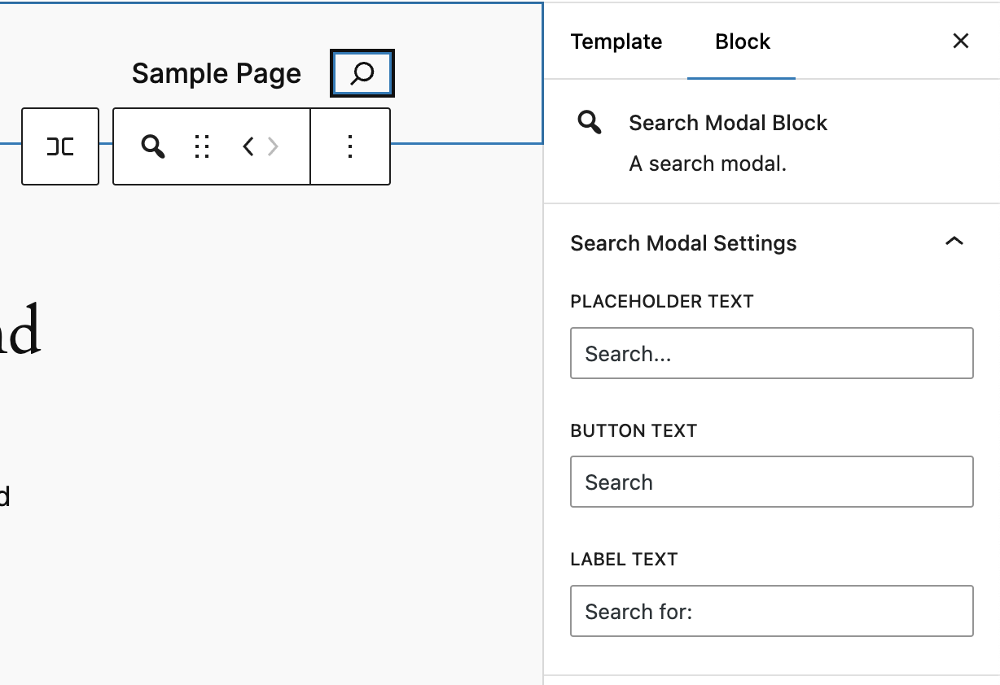
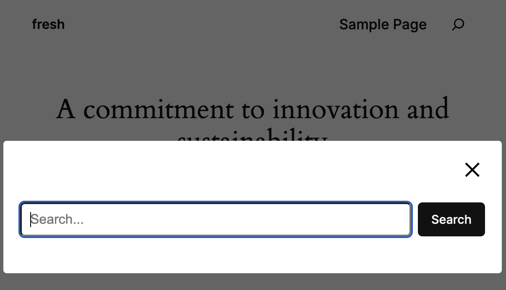

# Search Modal Block

[](https://github.com/philhoyt/search-modal-block/actions/workflows/ci.yml)
[](https://playground.wordpress.net/?blueprint-url=https://raw.githubusercontent.com/philhoyt/search-modal-block/main/_playground/blueprint.json)

A block that shows a search icon and opens the site search form in a modal dialog when clicked.

Published on WordPress.org as [search-modal-block](https://wordpress.org/plugins/search-modal-block/). The block is registered as `ph/search-modal`.




## Requirements

- WordPress 6.1 or newer
- PHP 7.4 or newer

## Installation

Install it from Plugins > Add New in wp-admin, or download the zip from a [GitHub release](https://github.com/philhoyt/search-modal-block/releases) and upload it on Plugins > Add New > Upload Plugin. Then activate it and add the Search Modal Block in the editor.

## Usage

The block has no inner blocks. All settings are in the inspector, in two panels:

| Panel | Setting | Attribute | Default |
|---|---|---|---|
| Modal Settings | Placeholder Text | `placeholderText` | `Search...` |
| | Button Text | `buttonText` | `Search` |
| | Label Text | `labelText` | `Search for:` |
| | Show Label | `showLabel` | `false` |
| Icon Settings | Button Icon (media library image, or the default icon) | `iconUrl` | empty |
| | Icon Size (S, M, L, XL, or Custom in px, em, rem, %) | `iconSize` | `1.5rem` |

The presets are 1rem, 1.5rem, 2rem, and 2.5rem. `blockId` is generated per block and ties the trigger button to its dialog.

## How it works

`save.js` writes the whole thing as static markup: a trigger `<button data-micromodal-trigger>`, then a hidden `.modal` container with `role="dialog"`, `aria-modal="true"`, a screen-reader-only `<h2>` title, a close button, and a `GET` form with `name="s"` and `type="search"`. The form carries `wp-block-search` and `wp-block-button__link` classes so theme styles for the core Search and Buttons blocks apply.

`view.js` initialises [MicroModal](https://micromodal.vercel.app/) on `DOMContentLoaded` with `disableScroll`, `awaitOpenAnimation`, and `awaitCloseAnimation`. MicroModal handles focus, Escape, and overlay clicks.

The form is saved with `action="/"`. A `render_block` filter in `search-modal-block.php` rewrites that to `home_url( '/' )` on output, so subdirectory and multisite installs search the right site. That is the only PHP in the plugin beyond `register_block_type()`.

`src/deprecated.js` holds the save functions for the 1.0.0, 1.1.0, and 1.2.0 markup so older blocks migrate instead of showing as invalid. Any change to `save.js` output needs a new entry there, and `src/deprecations.test.js` checks each one against its recorded markup.

## Development

```bash
npm install
composer install

npm start              # wp-scripts watch
npm run build          # production build to build/
npm run lint           # lint:css, lint:js, and lint:scss
npm run format
npm run test:unit      # Jest (src/deprecations.test.js)
npm run env:start      # wp-env with the plugin installed
npm run test:php       # PHPUnit in the wp-env tests container
npm run test:e2e       # Playwright (no specs yet)
npm run env:stop
npm run plugin-zip

composer run lint      # phpcs
composer run lint:fix  # phpcbf
composer run analyse   # phpstan
composer run test      # phpunit on the host
```

CI (`.github/workflows/ci.yml`) runs phpcs and phpstan on PHP 7.4, 8.1, 8.2, and 8.3, and lint plus build on Node 24.

## Releases

Bump `Version` in `search-modal-block.php`, `version` in `package.json` and `src/block.json`, and `Stable tag` in `readme.txt`, add a changelog entry, then push a bare version tag with no `v` prefix:

```bash
git tag 1.3.1 && git push origin 1.3.1
```

The deploy workflow (`.github/workflows/release.yml`) only matches tags of the form `[0-9]+.[0-9]+.[0-9]+`. It builds the assets, pushes the plugin to WordPress.org SVN with `10up/action-wordpress-plugin-deploy` (honouring `.distignore`), then creates a GitHub release with the generated zip and the matching `= X.Y.Z =` block from `readme.txt` as the notes. Two older tags (`V1.0.0`, `v1.2.0`) predate the bare format.

What ships: `build/`, `assets/`, `src/`, `search-modal-block.php`, and `readme.txt`. `src/` is included on purpose as the source for `build/`.

## Limitations

- One search form per modal, pointing at the site's default search. There is no post-type filter or custom endpoint.
- The trigger is always an icon button; there is no text-only trigger.
- The icon is an `` when custom, so SVG uploads need a plugin that allows SVG in the media library.
- The stylesheet is page-scoped on block themes only; classic themes load it on every page.

## Credits

[MicroModal](https://micromodal.vercel.app/) (ISC) drives the dialog.
